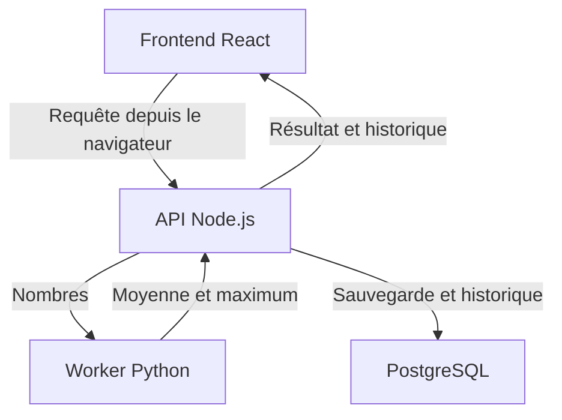

# EcoTrack Analytics

Une organisation souhaite analyser des séries de mesures et conserver les résultats. Depuis une page React, l’utilisateur lance un calcul. L’API Node.js demande au service Python de calculer la moyenne et le maximum, puis enregistre le résultat dans PostgreSQL. La page affiche le résultat et l’historique.



Le JavaScript React s’exécute dans le navigateur. Le conteneur frontend sert les fichiers de la page. Le navigateur appelle localhost:5000 ; dans Docker, l’API contacte worker et db par leur nom de service.

## Votre mission

### 1. Identifier les services

| Dossier ou service | Technologie | Commande de lancement | Port |
|---|---|---|---|
| frontend | React et serveur Node.js | npm run build puis npm start | 8080(hôte)/3000(container) |
| api | Node.js Express | npm start | 5000 |
| worker | Python Flask | python app.py | 8000 |
| db | Image postgres:15-alpine | À configurer dans Compose | 5432 interne |


### 2. Tester Python avec un venv

Windows PowerShell :

```powershell
py -m venv .venv
.\.venv\Scripts\Activate.ps1
```

Linux ou macOS :

```bash
python3 -m venv .venv
source .venv/bin/activate
```

Puis :

```bash
python -m pip install -r requirements.txt
python -c "import sys; print(sys.executable)"
python app.py
```

Le chemin Python doit contenir .venv. Ouvrir http://localhost:8000/health : résultat attendu {"status":"ok"}.


### 3. Créer les images

Trois Dockerfiles ont été créés pour construire les images des services frontend, API et worker.

- **Frontend** : image basée sur `node:20-alpine`, installation des dépendances et compilation de l'application React.
- **API** : image basée sur `node:20-alpine`, installation des dépendances Node.js et lancement du serveur Express.
- **Worker** : image basée sur `python:3.12-slim`, installation des dépendances Python et lancement de l'application Flask.

Chaque service possède également un fichier `.dockerignore` afin d'exclure les fichiers inutiles de la construction des images.

### 4. Configurer Compose

Le fichier `compose.yaml` orchestre les quatre services :

- `frontend` : interface React, accessible depuis le port 8080.
- `api` : serveur Node.js, accessible depuis le port 5000.
- `worker` : service Python, accessible uniquement depuis le réseau interne.
- `db` : base PostgreSQL, accessible uniquement depuis le réseau interne.

Deux réseaux Docker ont été créés :

- `reseau_public` : utilisé par le frontend et l'API.
- `reseau_interne` : utilisé par l'API, le worker et PostgreSQL. Ce réseau est déclaré avec `internal: true`.

Un volume nommé `pg_data` assure la persistance des données PostgreSQL.

### 5. Ajouter le secret

Le mot de passe PostgreSQL est stocké dans le fichier local `db_password.txt`.

Ce fichier est déclaré comme secret Docker dans `compose.yaml` et monté dans les conteneurs PostgreSQL et API sous `/run/secrets/db_password`.

Les variables `POSTGRES_PASSWORD_FILE` permettent aux services concernés de retrouver le fichier contenant le mot de passe.

Le fichier `db_password.txt` est exclu du dépôt Git grâce au `.gitignore`. Il ne doit jamais être ajouté au dépôt.

Quand vous clonez le dépot créer un fichier db_password.txt à la racine du projet et inserez un mot de passe dedans exemple: 1234

### 6. Lancer et vérifier

À la racine, après création des fichiers Docker :

```bash
docker compose config -q
docker compose up -d --build
docker compose ps -a
```

Ouvrir http://localhost:8080 pour l’interface et http://localhost:5000/status pour vérifier les trois services backend.


Si nécessaire :

```bash
docker compose logs api
docker compose logs worker
docker compose logs db
docker compose logs frontend
docker compose down
```

### 7. Compléter le dépôt et remettre

#### Vérifications réalisées

**1. Vérification des services**

Les quatre conteneurs ont été construits et démarrés avec Docker Compose. L'interface React est accessible sur le port 8080 et l'API sur le port 5000.

**2. Vérification des calculs**

Plusieurs séries de nombres ont été envoyées à l'API.

Exemple :
- Entrée : `[10, 20, 30]`
- Moyenne obtenue : `20`
- Maximum obtenu : `30`

Un second test avec `[10, 20, 30, 40, 50]` a également retourné une moyenne de `30` et un maximum de `50`.

**3. Vérification de l'historique et de la persistance**

Les résultats des analyses sont enregistrés dans PostgreSQL. Après l'arrêt puis le redémarrage des conteneurs avec `docker compose down` et `docker compose up -d`, les quatre enregistrements précédemment créés étaient toujours présents.

**4. Vérification de l'isolation réseau**

L'inspection des réseaux Docker a confirmé la répartition suivante :

| Service | Réseau interne | Réseau public |
|---|---|---|
| Frontend | Non | Oui |
| API | Oui | Oui |
| Worker | Oui | Non |
| PostgreSQL | Oui | Non |

Le réseau `reseau_interne` possède bien la propriété `internal: true`.

**5. Vérification des secrets**

Le fichier `db_password` est présent dans `/run/secrets/` des conteneurs API et PostgreSQL. Le fichier local `db_password.txt` est exclu du suivi Git.

#### Commandes utilisées

Construction et démarrage :

```bash
docker compose up -d --build
```

Vérification des conteneurs :

```bash
docker compose ps -a
```

Arrêt :

```bash
docker compose down
```

Consultation des logs :

```bash
docker compose logs api
docker compose logs worker
docker compose logs db
docker compose logs frontend
```

#### Remise du projet

Alexandre Pech--Rossell Groupe B2

### Endpoints fournis

| Service | Méthode et chemin | Rôle |
|---|---|---|
| worker | GET /health | Vérifier Python |
| worker | POST /analyze | Recevoir {"numbers":[10,20,30]} et calculer |
| api | GET /health | Vérifier le processus Node.js |
| api | GET /status | Vérifier PostgreSQL et worker |
| api | POST /analyze | Calculer via Python et enregistrer |
| api | GET /history | Lire les 50 derniers résultats |
